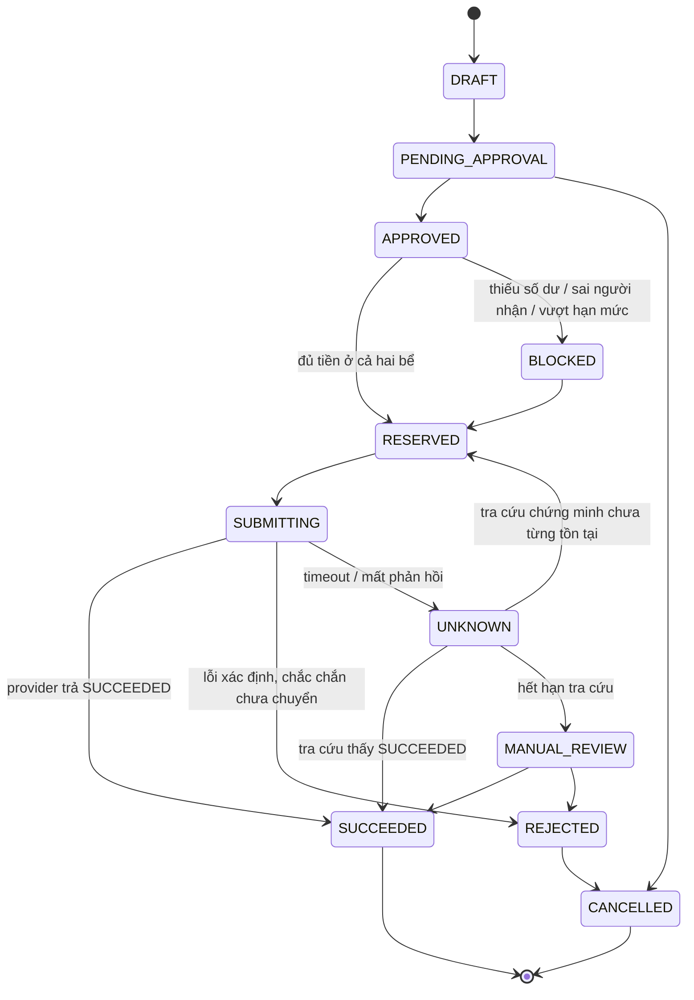

# payOS cho mô hình thu–chi B2B: hồ sơ thẩm định, thiết kế và điều kiện quyết định

**Trạng thái: HOLD.** Hồ sơ đã đủ để gửi payOS. Không mở thêm vòng thiết kế cho tới khi có câu trả lời làm thay đổi quyết định.

Tài liệu này **không** sửa mã sản phẩm, không thêm migration/endpoint/dependency, không gọi API, không chuyển tiền.

## 0. Xuất xứ và mốc đối chiếu

| Trường | Giá trị | Cách xác minh |
| --- | --- | --- |
| Ngày lập | 2026-10-30 | — |
| Nhánh làm việc | `arena/dae391e3-sadec-opc-webapp` | `git branch --show-current` |
| HEAD của checkout này | `0f2e0dd337f85bb555e662770a7ab5207fead340` (= `main`) | `git rev-parse HEAD` |
| PR #21 | OPEN, draft, base `main` | `gh pr view 21 --json state,isDraft,headRefOid` |
| **SHA đối chiếu cho mọi nhận định về PR** | **`7a765ba2c2f89abcc842aeab09c6e1c4489df097`** | xác minh 2026-10-30 |
| Nội dung PR đọc qua | GitHub API tại đúng SHA trên (`contents?ref=7a765ba…`) | không đổi checkout, không fetch, không reset |
| Kiểm thử đã chạy trong vòng này | **không có** | — |
| Trạng thái CI của checkout này | **không xác định, không dùng làm dẫn chứng** | — |

**Về số liệu kiểm thử.** Vòng này không chạy `pnpm verify` hay E2E, nên tài liệu **không** nêu số test hay trạng thái CI như một thuộc tính của checkout `0f2e0dd`. Nếu cần dẫn chứng kiểm thử của PR #21, phải ghi rõ là "trên head `7a765ba`, không phải trên checkout này", và chỉ sau khi tự chạy lại.

**Về giới hạn của phiên trước.** Vòng 9 chỉ đưa ra kết luận trong hội thoại vì phiên đó bị **hạn chế quyền ghi**. Nhánh và PR #21 vẫn mở trong suốt thời gian đó. Bản trong repo này thay thế bản trong hội thoại.

---

## 1. Cách đọc nhãn nguồn

| Nhãn | Nghĩa |
| --- | --- |
| **[A] tài liệu chính thức** | Đọc được trong tài liệu/trang chính thức của payOS, trích dẫn được URL. |
| **[B] cần xác nhận theo tài khoản** | Có dấu hiệu trong tài liệu nhưng chỉ đúng/đủ khi payOS xác nhận cho **pháp nhân cụ thể** này. |
| **[C] chưa xác minh được** | Không tìm thấy trong tài liệu đã đọc tính đến 2026-10-30. Không dùng để ra quyết định. |
| **[GT] giả định nội bộ** | Số/hành vi do nội bộ đặt để tính toán. Không phải dữ kiện. |
| **[MAIN]** | Đọc từ mã tại `0f2e0dd`. |
| **[PR21]** | Đọc từ mã tại `7a765ba`. |
| **[FUTURE]** | Thiết kế đề xuất, **chưa tồn tại** trong bất kỳ nhánh nào. |
| **[MKT]** | Nội dung tiếp thị của payOS. Không phải điều khoản hợp đồng, không phải phê duyệt theo tài khoản. |

**[C] nghĩa là "chưa xác minh được trong tài liệu đã đọc"**, không phải "payOS không có". Một endpoint vắng mặt trong tài liệu công khai có thể vẫn tồn tại theo hợp đồng.

---

## 2. Sổ hiệu chỉnh so với bản trước

| # | Kết luận cũ | Kết luận đúng | Vì sao |
| --- | --- | --- | --- |
| 1 | "Nạp nguồn chi tất yếu là ứng vốn nền tảng." | **Sai.** Cấp nguồn bằng tiền khách đã thu là **luân chuyển tiền khách**. Chỉ thành ứng vốn khi chi trước khi khoản thu tương ứng về và đối soát xong. | Bản chất khoản tiền, không phải thao tác nạp. |
| 2 | "Bốn ngân hàng tài trợ kênh chi." | **Bốn đối tác kết nối**: OCB, **Bảo Kim (ví điện tử)**, ShinhanBank, PVComBank. Bảo Kim là ví/đối tác kết nối, không phải ngân hàng. Ngân hàng nào/ví nào thực sự được cấp cho pháp nhân này là [B]. | Trang ra mắt kênh chi [MKT]. |
| 3 | "payOS không có API hoàn tiền và không có webhook chi." | **"Chưa xác minh được trong tài liệu đã đọc"** [C]. | Không biến "không thấy" thành "không có". |
| 4 | "Phí chi 5.000đ/lệnh (theo tài liệu)." | **Không phải báo giá.** Là giá trị trong **ví dụ phản hồi** `estimate-credit`; dùng làm [GT], không dùng làm biểu phí. | Tài liệu API không phải bảng giá. |
| 5 | "Phí thu 1,5% + 1.500đ." | **[GT]** từ nguồn không chính thức, mâu thuẫn với [MKT] "miễn phí thu". | Nguồn diễn đàn. |
| 6 | "Cần 15,6M–468M vốn lưu động." | **Phân loại lại**: đó là **số dư nguồn chi làm từ tiền khách đã thu**, không phải vốn chủ (mục 9). | Trộn hai bể tiền. |
| 7 | "Phải thêm bảng mới." | **Sai cách tiếp cận.** PR #21 đã tách nghĩa vụ khỏi dòng tiền; phải đánh giá đủ schema PR trước, rồi chỉ đề xuất phần nó **không thể** biểu diễn (mục 5.2). | Chưa đọc 0005 khi kết luận. |
| 8 | "`UNIQUE (booking_id, entry_type)` bảo vệ retry." | **Sai.** Constraint chống **ghi trùng cục bộ**, không làm retry an toàn và không phân biệt retry cùng ý định với một lần thu/chi mới (mục 6.2). | Xem 6.2. |
| 9 | "45.300đ = 1,69%; cần phí 3,65%." | Số cũ dựa trên cơ sở chi phí có lẫn một khoản hoàn trong kịch bản nghiệm thu đủ. Tính lại ở mục 10: **45.900đ = 1,714%** (vẫn là chỉ số nhạy, không phải ngưỡng phí) và **3,631%** (công thức đúng, phụ thuộc F). | Xem 10.6. |

---

## 3. Ma trận năng lực

| # | Năng lực cần | Kết luận | Nhãn |
| --- | --- | --- | --- |
| 1 | **Phạm vi mô hình**: nhận tiền người mua rồi trả nhiều nhà vườn | Ghép được về API: `POST /v2/payment-requests` để thu; `POST /v1/payouts` và `/payouts/batch` để chi. **Không có văn bản nào xác nhận mô hình "nhận hộ rồi trả hộ nhiều bên" được chấp thuận.** FAQ nêu ví dụ "sàn TMĐT cần chi trả cho seller" — gợi ý, không phải điều khoản. | API [A]; quyền mô hình [C] |
| 2 | **Kênh chi và nguồn tiền** | Cần tài khoản doanh nghiệp đã xác minh, ≥1 tài khoản ngân hàng liên kết, bật "Kênh chi" trong *Thiết lập → Hồ sơ → Thay đổi dịch vụ*, tạo kênh chuyển tiền với hạn mức, **IP allowlist**, **bộ khoá API riêng**. Danh mục kênh thực được cấp: [B]. Có chi trực tiếp từ tài khoản đang nhận tiền thu được không: [C]. Cơ chế/độ trễ cấp nguồn: [C]. | [A]/[B]/[C] |
| 3 | **Quyền thu/chi/hoàn**: hồ sơ, cấu hình | Hồ sơ doanh nghiệp + xác minh + liên kết ngân hàng + bật dịch vụ chi [A]. Quyền hoàn tiền và hồ sơ riêng cho hoàn: [C]. | [A]/[C] |
| 4 | **Trạng thái cuối, timeout, tra cứu, chống chi trùng** | Thu: webhook có `signature`, `POST /confirm-webhook`, `GET /v2/payment-requests/{id}` trả `status`, `amountPaid`, `amountRemaining`, `transactions[]` [A]. Chi: `GET /v1/payouts` (lọc `referenceId`), `GET /v1/payouts/{id}`, `approvalState` ∈ `PROCESSING`, `SUCCEEDED` [A]. Webhook chi: [C]. Ngữ nghĩa timeout: [C]. Thời hạn bảo đảm `x-idempotency-key`: [C]. | [A]/[C] |
| 5 | **Phí, hạn mức, phí thất bại, phí cấp nguồn** | Không có bảng biểu phí công bố. [MKT] nói thu "miễn phí", chi "chi phí thấp" — không phải bảng giá. `estimate-credit` trả phí theo từng lần gọi [A] nhưng giá trị trong tài liệu là ví dụ. Hạn mức thể hiện qua mã lỗi (theo giao dịch/ngày/tháng) [A]. Phí nạp/rút ví, số dư tối thiểu, phí giao dịch thất bại: [C]. | [A]/[MKT]/[C] |
| 6 | **Xác minh người nhận, dừng khẩn cấp** | `toBin` + `toAccountNumber`, cờ `validateDestination` ở lệnh chi theo lô [A]; hành vi thật khi tài khoản sai/đóng: [B]. Dừng khẩn cấp: có trạng thái "Kênh thanh toán đã tạm dừng" [A] nhưng **ai** bật/tắt và có endpoint không: [C]. Quy trình duyệt nhiều cấp: [C]. | [A]/[B]/[C] |
| 7 | **Đối soát** | Xem dòng 4. Bổ sung: giờ chốt sao kê ngân hàng và độ trễ đối soát: [C]. | [A]/[C] |
| 8 | **Kiểm thử** | payOS công bố **không có sandbox riêng**; thử trên môi trường thật bằng tài khoản đã xác minh CCCD, khuyến nghị số tiền nhỏ [A]. Cách kiểm chứng **không chuyển tiền** cho pháp nhân: [C]. Điều kiện cho phiên thật số tiền nhỏ có phê duyệt riêng: [C]. | [A]/[C] |

---

## 4. Dòng tiền và ba bể tiền

```
Người mua              Sa Đéc OPC                                payOS                Nhà vườn
    │                     │                                       │                     │
    │ cọc 780.000         │                                       │                     │
    ├── kênh thu ────────►│ BỂ A — tài khoản nhận                 │                     │
    │ còn lại 1.898.000   │ · tiền khách đã thu                   │                     │
    ├────────────────────►│ · chưa đối soát ⇒ chưa dùng được      │                     │
    │                     │                                       │                     │
    │                     │ đối soát sao kê ⇒ dành riêng/booking   │                     │
    │                     │                                       │                     │
    │                     │ nhân sự cấp nguồn (thủ công, có log)   │                     │
    │                     ├──────── cấp nguồn ──────────────────►│ BỂ B — số dư kênh   │
    │                     │                                       │ chi                 │
    │                     │ lệnh chi (intent) ───────────────────►├── chuyển khoản ───►│
    │                     │◄──── tra cứu trạng thái ──────────────┤                     │
    │◄── hoàn ────────────┴──── lệnh chi loại REFUND ─────────────┤                     │
```

| Bể | Chứa gì | Thuộc ai | Dùng để |
| --- | --- | --- | --- |
| **A — tài khoản nhận** | Tiền người mua đã chuyển | Người mua cho tới khi nghĩa vụ xác lập; nền tảng giữ hộ | Đối soát, dành riêng, cấp nguồn |
| **B — số dư kênh chi** | Tiền đã chuyển sang nguồn chi, đã dành cho lệnh cụ thể | Vẫn là tiền khách đã dành, **không phải vốn nền tảng** | Thực thi lệnh chi |
| **C — tiền của nền tảng** | Chỉ phần **phí nền tảng giữ lại** | Nền tảng | Bù chênh lệch, vận hành, đệm rủi ro |

Phí nền tảng không vào bể B. Nhờ vậy "chi vượt tiền đã thu" là trạng thái **không biểu diễn được**, không phải lỗi kiểm bằng mắt.

---

## 5. Ba lớp schema phải phân biệt

Cùng một câu hỏi "có chỗ ghi nhiều lần thu/chi không?" có ba câu trả lời khác nhau tuỳ phiên bản:

| Thành phần | **[MAIN] `0f2e0dd`** | **[PR21] `7a765ba` (0005–0007)** | **[FUTURE] đề xuất** |
| --- | --- | --- | --- |
| Nghĩa vụ quyết toán | Không có bảng riêng. Nằm trong `b2b_bookings` + kết quả tính tại chỗ. | **`b2b_settlements`**, 1 dòng/booking (`booking_id UNIQUE`): `accepted_value_vnd`, `platform_fee_vnd`, `buyer_balance_required_vnd`, `buyer_refund_vnd`, `nursery_payout_vnd`, `balance_collected_vnd`/`_ref`/`_at`, `status` ∈ `AWAITING_BALANCE`\|`READY_TO_RELEASE`\|`RELEASED`. | Giữ nguyên, không thay. |
| Dòng tiền | `escrow_ledger_entries`, `UNIQUE (booking_id, entry_type)`. | **Không đổi.** 0005 là additive; constraint cũ **vẫn tồn tại**. | Giữ nguyên cho dòng tiền đã xác nhận. |
| Ghi nhận cọc | `confirmDeposit()` đặt `deposit_paid_vnd = deposit_required_vnd`, ghi 1 dòng `DEPOSIT_HELD`. | Như trên (chỉ thêm đường dẫn tới settlement). | Cần **nhiều lần thu** ⇒ thêm `collect_intent`. |
| Ghi nhận quyết toán | Ghi thẳng 4 dòng ledger ngay khi nghiệm thu (sai về mặt kế toán: ghi tiền chưa nhận). | `confirmSettlement()` chuyển `status='RELEASED'` trong `db.batch`, các dòng ledger chỉ được `INSERT … SELECT` khi settlement đã `RELEASED` và `released_at = now`, mỗi dòng chỉ khi cột tương ứng `> 0`. | Giữ nguyên cơ chế; thêm lớp lệnh chi. |
| Chống trùng HTTP | Không có. | `idempotency_keys`: PK `(workspace_id, action_path, idempotency_key)`, `request_hash`, `status` ∈ `in_progress`\|`completed`; `withIdempotency()` bọc **mọi** request không-GET, chỉ lưu phản hồi `< 500`, coi khoá `in_progress` quá **60 giây** là bỏ dở. | Giữ nguyên cho HTTP; **không** dùng làm định danh lệnh chi. |
| Định danh lệnh chi tới provider | Không có. | Không có. | `disbursement_intent` (mục 5.3). |
| Bằng chứng webhook | Không có. | Không có. | `provider_event`. |
| Sổ cấp nguồn | Không có. | Không có. | `funding_transfer` + phân bổ. |
| Đối soát ba chiều | Không có. | Không có. | `recon_line`. |

### 5.1 Vì sao PR #21 là nền tốt hơn, và nó đã giải quyết gì

0005 tách đúng hai thứ mà tích hợp payOS cần tách:

1. **Nghĩa vụ ≠ tiền đã nhận.** `b2b_settlements` giữ con số nghiệm thu *tính ra*; `escrow_ledger_entries` chỉ giữ dòng tiền **một người đã xác nhận**. Trước 0005, nghiệm thu ghi luôn `NURSERY_PAYOUT_RELEASED` cho tiền chưa ai trả — đúng loại lỗi mà một tích hợp thanh toán thật sẽ biến thành lỗi tiền.
2. **Ghi có điều kiện trong một batch.** `UPDATE … WHERE status IN ('AWAITING_BALANCE','READY_TO_RELEASE')` + kiểm `changes` + các dòng ledger chỉ chèn khi settlement đã `RELEASED` tại đúng mốc `released_at`; nếu batch thua, không dòng nào được ghi và lỗi là 409. Đây là **giao dịch cục bộ đúng**, và nó chống *xác nhận trùng*, không phải chống *chi trùng ở ngân hàng*.

### 5.2 Cái PR #21 vẫn không biểu diễn được (khoảng trống cụ thể)

Đọc từng điểm, không suy đoán:

| # | Khoảng trống | Bằng chứng ở `7a765ba` | Hệ quả với payOS |
| --- | --- | --- | --- |
| G-1 | Không có chỗ cho `referenceId`/`x-idempotency-key` của provider, cũng không có trạng thái lệnh chi | `b2b_settlements` chỉ có các cột nghĩa vụ + `balance_collected_*`; không cột nào chứa định danh ngoài | Không thể tra cứu một lệnh chi đã gửi, không thể phát hiện "đã chi nhưng mất phản hồi" |
| G-2 | Không có lịch sử **nhiều lần thử** | Mỗi booking đúng 1 settlement; ledger `UNIQUE (booking_id, entry_type)` ⇒ tối đa 1 `NURSERY_PAYOUT_RELEASED` | Lần gửi lại hợp lệ (sau khi tra cứu thấy chưa tồn tại) không có chỗ ghi |
| G-3 | Không có **nhiều lần thu** | `deposit_paid_vnd` + `balance_collected_vnd` là hai cột cộng dồn, mỗi cột một `ref`/`at`; `CHECK (balance_collected_vnd <= buyer_balance_required_vnd)` | Thu làm nhiều đợt, thu thiếu/thu thừa, thu bù — không biểu diễn được |
| G-4 | Không có **hoàn một phần** hay nhiều lệnh hoàn | Ledger `UNIQUE (booking_id, entry_type)` ⇒ tối đa 1 `BUYER_REFUND` | Hoàn hai đợt, hoàn bổ sung sau khiếu nại: không có chỗ |
| G-5 | Không có sổ **cấp nguồn** | Không bảng nào theo dõi tiền ở bể B | Không biết số dư kênh chi thuộc về nghĩa vụ nào; không chứng minh được "không lấy tiền đơn khác" |
| G-6 | Không có **bằng chứng webhook** | Không bảng nào lưu payload/ chữ ký | Không điều tra được webhook lặp/sai thứ tự/sai chữ ký |
| G-7 | Không có **đối soát** | Không bảng nào đối chiếu provider ↔ sổ ↔ sao kê | Lệch không phát hiện được |

### 5.3 Đề xuất **tối thiểu**, chỉ sau khi GO

Nguyên tắc: **không** dựng lại thứ PR #21 đã có. Chỉ thêm bảng cho những gì cấu trúc hiện tại **không thể** chứa (G-1…G-7), giữ `b2b_settlements` là bản ghi nghĩa vụ duy nhất và `escrow_ledger_entries` là bản ghi dòng tiền đã xác nhận.

| Bảng | Chứa | Giải G- |
| --- | --- | --- |
| `collect_intent` | `id`, `booking_id`, `purpose`, `amount_vnd`, `order_code` (số nguyên, duy nhất), `status`, `provider_ref`, `paid_vnd`, `reconciled_at` | G-3 |
| `disbursement_intent` | `id`, `settlement_id`, `kind` ∈ `NURSERY_PAYOUT`\|`BUYER_REFUND`, `amount_vnd`, `payee_*`, `idempotency_key` UNIQUE, `request_hash`, `state`, `attempt_no`, `provider_ref`, `approved_by` | G-1, G-2, G-4 |
| `provider_event` | `external_id` UNIQUE, `signature_valid`, `raw_body`, `applied_at` | G-6 |
| `funding_transfer` | `from_pool`, `to_pool`, `amount_vnd`, `bank_ref`, `actor_id` | G-5 |
| `recon_line` | `source` ∈ `PROVIDER`\|`LEDGER`\|`BANK`, `external_ref`, `amount_vnd`, `booking_id`, `matched_at` | G-7 |

Đây vẫn là **đề xuất**, không phải quyết định: số bảng và tên cột phải chốt cùng lúc với việc payOS trả lời câu 4 trong `docs/PAYOS-QUESTIONS-FOR-PAYOS.md`, vì câu trả lời quyết định có cần `attempt_no`/`state` phức tạp hay không.

---

## 6. Chống trùng: ba thứ khác nhau, đừng gộp

### 6.1 Ba khái niệm

| Khái niệm | Câu hỏi | Công cụ đúng |
| --- | --- | --- |
| **Retry cùng một ý định** | Cùng một việc, gửi lại vì mất phản hồi | Khoá **bất biến theo ý định**, dùng lại qua mọi lần thử, ánh xạ tới `x-idempotency-key` của provider |
| **Hai ý định khác nhau, cùng loại** | Hoàn đợt 1 và hoàn đợt 2; chi lần 1 và chi lại sau sự cố | **Hai bản ghi riêng, hai khoá riêng** |
| **Hai bản ghi trùng do lỗi cục bộ** | Cùng một việc bị ghi hai dòng | Ràng buộc duy nhất ở DB (chặn dòng thứ hai) |

### 6.2 Điều `UNIQUE (booking_id, entry_type)` làm được và không làm được

**Làm được:** chặn dòng ledger thứ hai cùng loại cho cùng booking. Nếu `confirmSettlement` chạy hai lần, lần hai không tạo thêm dòng.

**Không làm được — và đây là chỗ bản trước kết luận sai:**

1. **Không nói gì về thế giới bên ngoài.** Constraint chỉ biết DB cục bộ. Nếu lần gửi thứ nhất tới ngân hàng và mất phản hồi, lần gửi thứ hai bị constraint chặn **không** chứng minh lần thứ nhất đã chuyển tiền. Ngược lại, nếu lần thứ nhất chưa tới nơi, constraint chặn lần thứ hai lại **ngăn** việc chi đúng. Cả hai chiều đều hỏng: constraint không phải bằng chứng, và không phải cơ chế thử lại.
2. **Gộp hai khái niệm 6.1.** Một lần hoàn thứ hai hợp lệ (khiếu nại sau đó) và một lần retry cùng ý định đều bị cùng một constraint chặn. Hệ quả: hoặc phải bịa `entry_type` mới, hoặc phải `UPDATE` dòng cũ — cả hai đều làm hỏng lịch sử.
3. **Không có khái niệm "đang chờ kết quả".** Constraint là nhị phân (có/không có dòng). Trạng thái thật của một lệnh chi có **ba** giá trị: chưa gửi, đã gửi chưa rõ kết quả, đã thành công. Bản trước coi "không có dòng thứ hai" là "an toàn"; thực tế an toàn chỉ đến từ việc **giữ khoản dành** và **tra cứu trước khi gửi lại**.

**Kết luận:** retry an toàn cần ba thứ cùng lúc — (a) định danh ý định bất biến ở phía ta, (b) khoá idempotency ở phía provider, (c) bằng chứng tra cứu được lưu lại. Constraint DB là lớp thứ tư, chỉ chống ghi trùng cục bộ.

### 6.3 `idempotency_keys` của PR #21 có dùng được cho lệnh chi không

Đọc `src/ops/idempotency.ts` tại `7a765ba`:

| Thuộc tính | Giá trị | Hệ quả với lệnh chi |
| --- | --- | --- |
| Phạm vi khoá | `(workspace_id, action_path, idempotency_key)` | Cùng chuỗi khoá ở route khác là khoá khác — tốt, nhưng **không** ánh xạ được sang `referenceId` của provider |
| Ràng buộc nội dung | `request_hash` = SHA-256(path + body) | Đổi payload ⇒ từ chối. Đúng cho retry, **cấm** sửa số tiền tại chỗ (phải tạo ý định mới) |
| Khoá bỏ dở | `in_progress` quá **60 giây** bị coi là bỏ dở | **Ngắn hơn** vòng đời một lệnh chi. Sau 60 giây, khoá có thể bị chiếm lại bởi một lần thử mới **trong khi lệnh cũ vẫn có thể đang chạy** |
| Lưu phản hồi | Chỉ `< 500` | Một 500 sau khi đã gửi lệnh ⇒ không có phản hồi lưu lại, lần sau chạy lại handler |
| Tuỳ chọn | `key === null` ⇒ không bảo vệ | Client quên header là mất bảo vệ, im lặng |

⇒ Dùng được cho **HTTP retry**, **không** dùng được làm định danh lệnh chi: nó không sống đủ lâu, không ánh xạ tới provider, và không có trạng thái "đã gửi, chưa rõ".

---

## 7. Máy trạng thái cho lệnh chi ([FUTURE])



| Luật | Nội dung |
| --- | --- |
| `SUBMITTING → UNKNOWN` | Timeout **luôn** là `UNKNOWN`; **không** giải phóng khoản dành |
| `UNKNOWN → RESERVED` | Chỉ sau khi tra cứu theo định danh trả về **không tồn tại**, và bằng chứng tra cứu đã lưu |
| `UNKNOWN → MANUAL_REVIEW` | Sau N lần tra cứu ([GT] N = 5 trong 30 phút) |
| `MANUAL_REVIEW → *` | Chỉ người, có bằng chứng đính kèm |
| `SUCCEEDED → *` | **Cấm sửa**; sai thì ghi bút toán đảo |
| Mọi chuyển sang `SUCCEEDED` | Cần bằng chứng: `SUCCEEDED` từ provider **hoặc** dòng sao kê; phản hồi "đã nhận lệnh" không đủ |

Bất biến tiền, kiểm trong cùng giao dịch ghi:

```
thu_đã_đối_soát(booking)  ≥  đã_chi(booking) + đã_dành(booking)     (1)
số_dư_kênh_chi            ≥  Σ đã_dành(mọi lệnh đang mở)             (2)
```

`platformOutlayVnd === 0` [MAIN/PR21] vẫn đúng và vẫn cần, nhưng là bất biến **số học trên một settlement**, không phải bất biến **số dư**. Thiếu (1)(2) thì code vẫn "đúng" trong khi tiền lấy từ đơn khác.

---

## 8. Trạng thái thu tiền

| Trạng thái | Nghĩa | Dùng được để chi? |
| --- | --- | --- |
| `REQUESTED` | Đã tạo yêu cầu thanh toán | Không |
| `PENDING` | Chưa có webhook hợp lệ | Không |
| `PAID_UNRECONCILED` | Webhook hợp lệ, chữ ký đúng, số tiền khớp | **Không** — chính sách yêu cầu đã đối soát |
| `RECONCILED` | Khớp dòng sao kê | **Có**, trong hạn mức của booking |
| `UNDERPAID` / `OVERPAID` | Lệch số tiền | Không — ngoại lệ, cần người quyết định |
| `EXPIRED` | Hết hạn yêu cầu | Không |
| `REVERSED` | Bị đảo | Không — phải kiểm lại bất biến (1) |

---

## 9. Số dư nguồn chi và vốn chủ sở hữu: hai đại lượng khác nhau

### 9.1 Số dư nguồn chi — làm từ tiền khách, không phải vốn chủ

Bằng tổng nghĩa vụ đến hạn trong khoảng thời gian cấp nguồn **L**, tính trên giá trị trả nhà vườn của đơn chuẩn (2.600.000đ):

| Quy mô | L = 1 ngày | L = 2 ngày | L = 3 ngày |
| --- | --- | --- | --- |
| 3 đơn/ngày | 7,8M | 15,6M | 23,4M |
| 20 đơn/ngày | 52M | 104M | 156M |
| 60 đơn/ngày | 156M | 312M | 468M |

### 9.2 Vốn chủ cần ứng

Ở trạng thái ổn định: **0**, với ba điều kiện đồng thời — (a) chỉ chi sau khi khoản thu tương ứng `RECONCILED`; (b) chỉ chi sau khi tiền đã thực sự ở bể B; (c) không có lệnh hoàn nào phải thực hiện trước khi thu hồi được từ nhà vườn.

Vi phạm bất kỳ điều kiện nào thì phần chênh **chính là** vốn chủ, và phải ghi là vi phạm chính sách, không phải "linh hoạt vận hành".

Rủi ro vốn chủ **không** tỷ lệ với giá trị đơn đang mở:

```
vốn chủ kỳ vọng = P(không thu hồi được) × phần không thu hồi được
```

[GT] 0,35% × 2.600.000 = **9.100đ/đơn**; cận trên là **một lần trả nhà vườn cho mỗi ca đang mở**, không phải toàn bộ sổ đơn. Tài liệu **không** kết luận mức vốn cần thiết từ tổng giá trị đơn đang mở.

### 9.3 Thời gian chu kỳ

`thu → webhook → đối soát sao kê → cấp nguồn → chi → xác nhận SUCCEEDED` — cả sáu chặng đều [C]. **Không cam kết thời hạn trả nhà vườn** cho tới khi đo được P50/P95.

---

## 10. Kinh tế đơn vị

### 10.1 Định nghĩa, dùng thống nhất trong toàn bộ tài liệu

| Ký hiệu | Nghĩa |
| --- | --- |
| `G` | Giá trị hàng **được nghiệm thu** |
| `F` | **Doanh thu phí nền tảng** = `platformFeeBps × G` |
| `C` | Tổng **chi phí biến đổi** của đơn |
| `CM` | `F − C` (lãi đóng góp) |
| **Mục tiêu** | **`CM / F ≥ 20%`** — tỷ lệ trên **doanh thu phí nền tảng**, không phải trên giá trị hàng |

`CM/G` chỉ dùng làm thông tin phụ, không dùng làm chỉ tiêu.

### 10.2 Dữ kiện [MAIN] + [PR21]

| Đại lượng | Giá trị | Nguồn |
| --- | --- | --- |
| Đơn giá × số lượng | 100 × 26.000 = 2.600.000đ | ví dụ chuẩn của sản phẩm |
| Tỷ lệ cọc | 30% | `deposit_rate_bps` 3000–5000 |
| Phí nền tảng | 3% × G | `platformFeeBps = 300`, miền 200–500 |
| Nghĩa vụ người mua | `G + F` | `finalBuyerObligationVnd` |
| Cọc phải thu | 780.000đ | `depositRequiredVnd` |
| Còn lại phải thu | `G + F − cọc` = 1.898.000đ | `buyerBalanceRequiredVnd` |
| Trả nhà vườn | `G` = 2.600.000đ | `nurseryPayoutVnd` |

Ở kịch bản nghiệm thu đủ: **hai** giao dịch thu (cọc + phần còn lại), **một** lệnh trả nhà vườn, **không** có hoàn.

### 10.3 Chi phí tính theo **số giao dịch**, không theo "mỗi đơn"

```
C = r × (tiền thực thu) + k × (số giao dịch thu)
  + p × (số lệnh trả nhà vườn) + p × (số lệnh hoàn)
  + cấp nguồn + đối soát/hỗ trợ + tổn thất kỳ vọng
```

- `r`, `k`: phí thu theo % và theo giao dịch — **[GT]**, chưa có bảng giá.
- `p`: phí mỗi lệnh chi — **[GT]**, không lấy ví dụ `estimate-credit` làm báo giá.
- Phí hoàn **chỉ** tính ở dòng lệnh hoàn; không cộng lại vào phí thu.

### 10.4 Ba kịch bản, công khai từng giả định

| Giả định | **S1** thu miễn phí | **S2** cơ sở | **S3** cao |
| --- | --- | --- | --- |
| `r` (phí thu theo %) | 0 | 1,5% | 1,5% |
| `k` (phí thu cố định/giao dịch) | 0 | 1.500đ | 1.500đ |
| Số giao dịch thu | 2 | 2 | 2 |
| `p` (phí mỗi lệnh chi) | 3.000đ | 6.000đ | 10.000đ |
| Số lệnh chi | 1 (trả nhà vườn) | 1 | 1 |
| Số lệnh hoàn | 0 | 0 | 0 |
| Cấp nguồn (phân bổ/đơn) | 0 | 2.000đ | 8.000đ |
| Đối soát + hỗ trợ | 10.000đ | 15.000đ | 25.000đ |
| Tổn thất kỳ vọng | 0 | 9.100đ (0,35%) | 26.000đ (1,0%) |
| **C** | **13.000** | **75.270** | **112.170** |
| **F** | 78.000 | 78.000 | 78.000 |
| **CM** | **65.000** | **2.730** | **−34.170** |
| **CM/F** | **83,3%** | **3,5%** | **−43,8%** |
| Đạt mục tiêu 20%? | **Có** | **Không** | **Không** |

Kiểm S2: `C = 1,5% × 2.678.000 + 1.500 × 2 + 6.000 + 2.000 + 15.000 + 9.100 = 40.170 + 3.000 + 32.100 = 75.270`. `CM = 78.000 − 75.270 = 2.730`. `2.730 / 78.000 = 3,5%`.

Chỉ S1 đạt mục tiêu. Nghĩa là **"thu miễn phí" không phải chi tiết phụ — nó là điều kiện để mục tiêu 20% tồn tại ở mức phí 3%.**

### 10.5 Nghiệm thu không đủ 100% — tính lại toàn bộ, không giữ nguyên doanh thu

Khi số đơn vị đạt giảm, `G` giảm ⇒ `F` giảm ⇒ nghĩa vụ và số lần thu cũng đổi. Bảng dưới tính lại **tất cả** các đại lượng (giả định S2, 3%, cọc 30% trên đơn gốc 2.600.000):

| Đơn vị đạt | `G` | `F` | Cọc | Còn lại | Hoàn | Số lần thu | `C` | `CM` | `CM/F` |
| --- | --- | --- | --- | --- | --- | --- | --- | --- | --- |
| 100/100 | 2.600.000 | 78.000 | 780.000 | 1.898.000 | 0 | 2 | 75.270 | 2.730 | 3,5% |
| 90/100 | 2.340.000 | 70.200 | 780.000 | 1.630.200 | 0 | 2 | 71.253 | −1.053 | −1,5% |
| 80/100 | 2.080.000 | 62.400 | 780.000 | 1.362.400 | 0 | 2 | 67.236 | −4.836 | −7,8% |
| 20/100 | 520.000 | 15.600 | 780.000 | 0 | 244.400 | **1** | 51.300 | −35.700 | −228,8% |

Dòng 20/100: nghĩa vụ cuối 535.600 < cọc 780.000 ⇒ **hoàn 244.400**, không thu phần còn lại ⇒ chỉ **một** giao dịch thu, **một** lệnh trả nhà vườn, **một** lệnh hoàn; `C = 13.200 + 6.000 + 6.000 + 2.000 + 15.000 + 9.100`. Đây là lý do phải đếm giao dịch: giảm một lần thu nhưng thêm một lệnh hoàn.

**Kết luận checkable:** ở mức phí 3%, chỉ cần **10% đơn vị không đạt** là `CM` đã âm. Mục tiêu 20% chỉ đứng vững khi tỷ lệ nghiệm thu đủ gần 100% **và** phí thu bằng 0.

### 10.6 Ngưỡng: chứng minh lại từ công thức

Với `F = f × G`, `C = r(G + F) + n·k + K` (`n` = số giao dịch thu, `K` = các chi phí còn lại):

```
CM/F ≥ 0,20
⇔ f·G − r(G + f·G) − n·k − K ≥ 0,20·f·G
⇔ f ≥ ( r + (n·k + K)/G ) / ( 0,80 − r )          (A)
```

Hoà vốn (`CM = 0`): `f = ( r + (n·k + K)/G ) / (1 − r)` (B).

Với `G = 2.600.000`, `n = 2`, `k = 1.500`, `K = 6.000 + 2.000 + 15.000 + 9.100 = 32.100`:

| Trường hợp | `f` cần cho 20% | `F` tương ứng | `f` hoà vốn |
| --- | --- | --- | --- |
| `r = 0` | **1,543%** | 40.125đ | 1,235% |
| `r = 1,5%` | **3,631%** | 94.395đ | 2,893% |

Kiểm `r = 1,5%`: `f = (0,015 + 35.100/2.600.000)/(0,80 − 0,015) = 0,0285/0,785 = 3,631%`. Tại đó `F = 94.395`; `C = 0,015 × 2.694.395 + 3.000 + 32.100 = 75.516`; `CM/F = 18.879/94.395 = 20,0%`. ✔

**Hai điều suy ra được, và cả hai đều là tin xấu cho mức phí 3%:**

1. Nếu phí thu là 1,5% + 1.500đ, mức phí nền tảng **bắt buộc ≥ 3,631%** — cao hơn 3% và chỉ còn 1,37 điểm phần trăm dưới trần 5% của chính sản phẩm (`platformFeeBps ≤ 500`).
2. Ngưỡng `r` mà tại đó mục tiêu 20% **không thể đạt được ngay cả ở trần 5%**: giải `(r + 0,0135)/(0,80 − r) = 0,05` ⇒ **`r ≈ 2,52%`**. Trên mức đó, phải hạ chi phí khác hoặc bỏ mục tiêu.

### 10.7 Số cũ 45.300đ / 1,69% / 3,65%: chứng minh hoặc bỏ

- **45.300đ / 1,69%**: bản trước tính `78.000 − 32.700 = 45.300`, chia cho tiền thu 2.678.000 ⇒ 1,69%. Nhưng `32.700` có chứa **600đ dự phòng phí hoàn trong một kịch bản nghiệm thu đủ, không có hoàn** — đúng kiểu trộn mà mục 10.5 loại bỏ. Với cơ sở đã sửa: `78.000 − 32.100 = 45.900`, trên 2.678.000 ⇒ **1,714%**.
- Bản thân con số này **không phải ngưỡng phí của payOS**, và không nên trích dẫn như vậy: nó là "phí thu tuyệt đối tối đa còn chịu được **khi giữ `F` cố định ở 78.000**". Giữ `F` cố định chính là điều mục 10.6 cấm khi suy ra mức phí nền tảng.
- **3,65%**: bản trước giải bằng cách **giữ chi phí thu cố định** rồi tìm `F`. Đúng phương pháp là (A): **3,631%** (chênh 0,019 điểm phần trăm ở đây, nhưng chênh lệch tăng theo `r`, nên không được dùng cách cũ).

**Kết luận trung thực:** ba con số cũ đều tái tạo được về mặt số học, nhưng hai trong ba dựa trên giả định sai phương pháp. Giá trị dùng được là bảng ở 10.6, và **tất cả** đều phụ thuộc `r` — một đại lượng chưa có. Cho đến khi có bảng phí thật, đây là **khoảng**, không phải kết luận.

### 10.8 Điều tài liệu này từ chối kết luận

- Không nêu "phí nền tảng nên là X%" như một quyết định: chưa có `r`, `p`, phí nạp/rút.
- Không dùng bất kỳ giá trị nào trong ví dụ phản hồi API làm báo giá.
- Không coi [MKT] "miễn phí thu" là phê duyệt theo tài khoản — đó là lý do S1 và S2 cùng tồn tại.

---

## 11. Bộ ca kiểm thử (thiết kế, chưa thực thi)

| # | Ca | Provider giả bơm | Kết quả mong đợi | Cấm |
| --- | --- | --- | --- | --- |
| T01 | Webhook sai chữ ký | `signature` sai | 401, không đổi trạng thái, lưu sự kiện cách ly | Ghi nhận tiền |
| T02 | Webhook lặp | Cùng `orderCode`+`reference` × 3 | Lần 1 áp dụng, lần 2–3 trả 200, không đổi | Cộng tiền hai lần |
| T03 | Webhook sai thứ tự | Webhook trước khi booking tồn tại | Lưu raw, chưa áp dụng, áp dụng lại sau | Mất khoản thu |
| T04 | Thu thiếu | `amountPaid` < yêu cầu | `UNDERPAID`, không dành riêng, không chi | Chi trước khi đủ |
| T05 | Thu thừa | `amountPaid` > yêu cầu | `OVERPAID`, chặn chi tự động | Tự chi phần thừa |
| T06 | Hai lệnh tranh số dư | Hai ý định, tổng > số dư | Một `RESERVED`, một `BLOCKED` | Cả hai `SUBMITTING` |
| T07 | Thiếu số dư nguồn chi | Bể B < khoản dành | `BLOCKED` **trước** khi gửi | Gửi rồi mới phát hiện |
| T08 | Timeout sau khi tiền đã chuyển | Nhận lệnh, không trả lời | `UNKNOWN`, giữ khoản dành | Sinh lệnh mới / giải phóng khoản dành |
| T09 | Tra cứu thấy SUCCEEDED | Trả `SUCCEEDED` | `SUCCEEDED`, lưu bằng chứng | Gửi lại |
| T10 | Tra cứu thấy không tồn tại | 404 | Được gửi lại **cùng khoá** | Đổi khoá |
| T11 | Người nhận sai | `validateDestination = false` | Từ chối trước khi gửi | Gửi lệnh |
| T12 | Vượt hạn mức | Lỗi hạn mức ngày | `REJECTED`, nghĩa vụ giữ nguyên | Chia nhỏ để lách |
| T13 | Hoàn một phần | Nghĩa vụ hoàn < số đã thu | Lệnh `BUYER_REFUND` riêng, khoá riêng | Dùng lại khoá của payout |
| T14 | Khoá chi trùng | "Idempotency key đã tồn tại" | Coi là **chưa xác định**, tra cứu thật | Đánh dấu thất bại rồi gửi lại |
| T15 | Nghĩa vụ đổi sau khi đã chi | Sửa kết quả nghiệm thu | Bút toán đảo | `UPDATE` dòng đã `SUCCEEDED` |
| T16 | Đối soát ba chiều lệch | payOS có, sổ không (và ngược lại) | Chặn chi mới trên booking lệch | Chi tiếp trên booking đang lệch |
| T17 | Kênh chi bị tạm dừng | "Kênh thanh toán đã tạm dừng" | Dừng tạo lệnh mới, vẫn tra cứu | Tự bật lại kênh |
| T18 | Không lấy tiền đơn khác | Booking A thiếu, B thừa | A chờ, báo thiếu | Lấy tiền của B |
| T19 | Khoá sống quá 60 giây | Lần thử sau 61 giây | Vẫn thuộc cùng ý định; **không** sinh lệnh mới | Để `idempotency_keys` tái sử dụng khoá |

Bộ này chưa chạy. Mỗi ca phải thành test tự động khi triển khai; không ca nào "đạt" bằng cách nới điều kiện.

---

## 12. Provider giả chứng minh được gì

| Chứng minh được | **Không** chứng minh được |
| --- | --- |
| Xử lý lặp/sai thứ tự/sai chữ ký, thiếu/thừa tiền, tranh số dư, timeout, người nhận sai, lệch đối soát | Chữ ký, header, hạn mức thật của payOS |
| Máy trạng thái không đi vào đường chi hai lần | Ngân hàng có chuyển tiền thật hay không |
| Khoá theo ý định ổn định qua retry và qua mốc 60 giây | Hành vi thật của `approvalState` khi timeout |
| Bất biến (1)(2) giữ dưới tải đồng thời | Phí, hạn mức, thời gian xử lý thật |
| Đối soát phát hiện lệch | Quyền của pháp nhân theo hợp đồng |

payOS công bố **không có sandbox riêng** [A] ⇒ kiểm chứng thật chỉ có thể là (a) phiên thật số tiền nhỏ có phê duyệt riêng, hoặc (b) chờ payOS cấp môi trường/giấy xác nhận. Cả hai **chưa thực hiện** và nằm ngoài phạm vi tài liệu này.

---

## 13. Điều kiện quyết định

### 13.1 GO — phải đúng **cả sáu**

| # | Cổng | Hiện trạng | Ai trả lời |
| --- | --- | --- | --- |
| G1 | payOS xác nhận **bằng văn bản** mô hình "nhận tiền người mua → trả nhiều nhà vườn/hoàn người mua" | **Chưa** [C] | payOS (câu 1) |
| G2 | Kênh chi được cấp; cơ chế/độ trễ cấp nguồn được xác nhận | **Chưa** [C] | payOS (câu 2) + chủ dự án |
| G3 | Hồ sơ và cấu hình cần cho quyền thu/chi/hoàn được xác nhận | **Chưa** [C] | payOS (câu 3) |
| G4 | Trạng thái cuối, xử lý timeout, cách tra cứu, bảo đảm chống chi trùng được mô tả | **Chưa** [C] | payOS (câu 4) |
| G5 | Bảng phí thật + hạn mức + phí thất bại + phí cấp nguồn | **Chưa** [C] | payOS (câu 5) |
| G6 | Xác minh người nhận, dừng khẩn cấp, phương án kiểm thử được chấp thuận; **và** `CM/F ≥ 20%` tính bằng phí thật | **Chưa** | payOS (câu 6) + chủ dự án |

Chỉ khi cả sáu đúng mới chuyển sang **lập kế hoạch tích hợp**; triển khai vẫn là quyết định riêng.

### 13.2 HOLD — trạng thái hiện tại

- **payOS:** sáu câu trong `docs/PAYOS-QUESTIONS-FOR-PAYOS.md`.
- **Chủ dự án:** ai duyệt lệnh chi, ngưỡng hai người, N lần tra cứu, ai chịu trách nhiệm khi lệch đối soát, có chấp nhận phí nền tảng > 3% hay không.
- **Cố vấn pháp lý/kế toán:** tiền giữ hộ hạch toán thế nào, có bị coi là tiền của nền tảng, nghĩa vụ thuế tại thời điểm thu hay thời điểm chi.

### 13.3 NO-GO trên payOS

Nếu (a) G1 trả lời **không** hỗ trợ nhiều người nhận; hoặc (b) cấp nguồn không đáp ứng vận hành đã chốt (không thể chuyển tiền khách sang nguồn chi, hoặc độ trễ lớn hơn cam kết có thể đưa ra); hoặc (c) G5 cho thấy chi phí khiến `CM/F ≥ 20%` bất khả thi ngay cả ở trần phí 5%.

NO-GO **không** đồng nghĩa dừng dự án: SePay là phương án dự phòng. **Không xây song song hai tích hợp.**

---

## 14. Dừng ở đâu

Hồ sơ này **đóng vòng nghiên cứu**. Không mở thêm vòng thiết kế cho tới khi có **một** trong các sự kiện sau:

1. payOS trả lời bất kỳ câu 1–6.
2. Chủ dự án chốt quyết định nội bộ ở 13.2.
3. Có quyết định chuyển sang SePay.

Khi đó, việc cần làm là **cập nhật mục 13.1** bằng nguyên văn câu trả lời kèm ngày và người trả lời — không viết lại hồ sơ.

---

## 15. Việc còn chờ

| # | Chờ gì | Loại | Chặn |
| --- | --- | --- | --- |
| 1 | Mô hình nhiều người nhận có được chấp thuận | Quyền | G1 |
| 2 | Kênh chi nào; có chi trực tiếp từ tài khoản thu được không | Quyền + vận hành | G2, mục 4 |
| 3 | Cơ chế và độ trễ cấp nguồn; có tự động không | Vận hành | 9.3, cam kết với nhà vườn |
| 4 | Hồ sơ/cấu hình cho quyền thu–chi–hoàn | Quyền | G3 |
| 5 | Trạng thái cuối, timeout, hạn bảo đảm idempotency | Kỹ thuật | G4, T08–T10, T19 |
| 6 | Bảng phí thật, hạn mức, phí thất bại, phí cấp nguồn | Kinh tế | G5, G6, mục 10 |
| 7 | Xác minh người nhận, xử lý chuyển sai, dừng khẩn cấp | Quyền + kỹ thuật | G6, T11 |
| 8 | Cách kiểm thử không chuyển tiền | Kiểm thử | G6 |
| 9 | Giờ chốt sao kê / độ trễ đối soát | Vận hành | mục 8, 9.3 |
| 10 | Ai duyệt lệnh chi, ngưỡng hai người | Nội bộ | mục 7 |
| 11 | Hạch toán tiền giữ hộ | Pháp lý/kế toán | mục 4, G6 |

---

## 16. Tự kiểm

| Tiêu chí | Trạng thái |
| --- | --- |
| Mọi nhận định về mã gắn đúng phiên bản ([MAIN]/[PR21]/[FUTURE]) | Đạt — mục 0, 5 |
| Mọi claim trọng yếu có nguồn chính thức hoặc được đánh dấu chưa xác nhận | Đạt — mục 3, mỗi dòng có nhãn |
| Không có lệnh chi vượt tiền đã thu còn khả dụng cho nghĩa vụ đó | Đạt ở mức thiết kế — bất biến (1)(2) mục 7, ca T06/T18 |
| Thiết kế xử lý thu nhiều lần, trả nhà vườn, hoàn người mua mà không trùng khoá | Đạt — 5.3, 6.1, T13 |
| Timeout không chi lại mù, không giải phóng khoản dành sớm | Đạt — mục 7, T08–T10, T19 |
| Kinh tế tính đúng số giao dịch, không mặc định phí bằng 0, không đếm kép | Đạt — 10.3–10.5 |
| "20%" định nghĩa thống nhất là tỷ lệ trên doanh thu phí nền tảng | Đạt — 10.1 |
| Không sửa code, gọi API, giao dịch, liên hệ nhà cung cấp, commit/merge/deploy | Đạt |
| Không mở thêm vòng nghiên cứu khi chưa có câu trả lời mới | Đạt — mục 14 |

**Chưa đạt và không thể đạt trong phạm vi tài liệu:** kiểm chứng trên hệ thống payOS thật; biểu phí thật; thời gian chu kỳ thật. Cả ba phụ thuộc mục 15.
