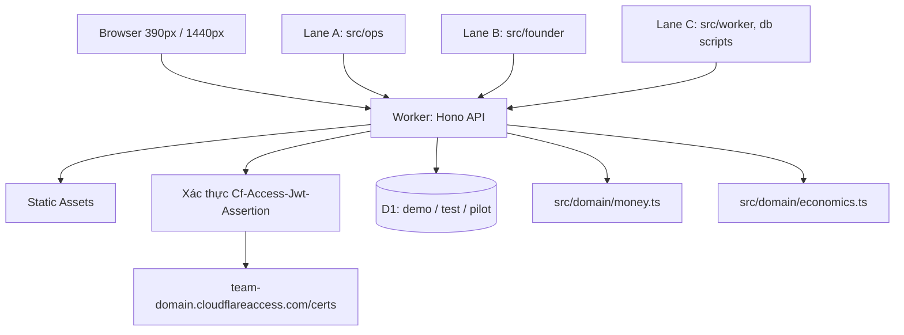

# Sa Đéc Flow — Part A delivery

**Outcome:** một webapp chạy được, phục vụ ba lần dùng thật: (1) founder tự demo
tại vườn trên dữ liệu DEMO ở localhost, (2) chủ cơ sở tự dùng thử trên URL
private sau Cloudflare Access, (3) founder trình diễn khu Founder cho đối tác.

**How It Works:**

- Giao diện React + TypeScript + Vite, một API Hono cùng origin chạy trên
  Cloudflare Workers phía sau Static Assets; `run_worker_first: ["/api/*"]` đưa
  mọi request API vào Worker bất kể có khớp asset hay không.
- Dữ liệu nằm trong D1, ba binding tách biệt `sadec-demo`, `sadec-test`,
  `sadec-pilot`; dev local dùng state directory bền vững, không in-memory, nên
  kiểm chứng được persistence qua restart.
- Hai khu nghiệp vụ — Vận hành cơ sở và Founder discovery — dùng chung schema,
  tách migration theo lane, chỉ integrator viết migration và merge.

**Architecture / Flow:**

**Advisor Scope Lock:** giữ nguyên toàn bộ phạm vi Part A của
`SADEC_OPC_SUPER_MASTER_PROMPT.md`, không cắt, không hoãn. Ngoài phạm vi:
marketplace, ERP, ví tiền, kế toán/thuế, app mobile native, OCR/LLM, tích hợp
Zalo/email/payment thật, mua domain, công khai ra internet. Phản biện chiến lược
được ghi trong `plans/261024-0154-sadec-flow-part-a/ultra-verdict.md` — một bản
tư vấn đã được sửa một khuyến nghị kỹ thuật sai trước khi dùng.

**Implementation metadata:**

- Branch: `feat/sadec-flow-part-a`
- Plan: `plans/261024-0154-sadec-flow-part-a/plan.md`
- Route: feature (`/ak:cook`)
- Ship mode: official (stable)
- Repo: private, `minhlongs/sadec-opc-webapp`
- Worktree: `/Users/macbook/projects/sadec-opc-wt-part-a`

**Acceptance Criteria:**

- [ ] Phase 0: một migration cho mọi entity §14; `money.ts` và `economics.ts`
      xanh; ba case §13 khớp từng đồng; `pnpm verify` in số test > 0
- [ ] Phase 1: lát cắt dọc chạy được, dữ liệu còn nguyên sau restart server
- [ ] Phase 2: báo giá có revision bất biến, đơn idempotent, receipt có
      confirmed/reversed, quyền xác nhận cọc được kiểm ở server
- [ ] Phase 3: interview/observation → proposal → ConfigVersion có rollback;
      import/export có preview và không apply một phần
- [ ] Phase 4: 16/17 ca §15 có lệnh + kết quả trong `docs/RELEASE.md`; ca 17
      chờ Phase 5
- [ ] Phase 5: URL pilot thật, `curl` chưa đăng nhập bị chặn, danh tính dev bị
      vô hiệu, pilot khởi tạo rỗng

**Pipeline State:**

- [x] Worktree + branch
- [x] Research (phiên bản thư viện, tài liệu Cloudflare, quyền token)
- [x] Plan drafted + red-team dispatched
- [ ] Validate + red-team findings resolved
- [ ] Issue created and labelled
- [ ] Implement (`/ak:cook`)
- [ ] Local code review
- [ ] Test + acceptance document
- [ ] Ship PR
- [ ] PR review/fix/reply
- [ ] Merge + CI
