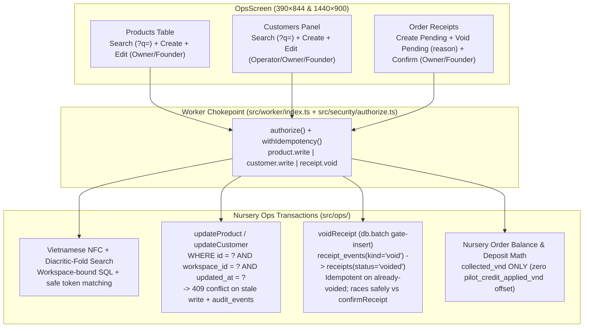

# Sa Đéc Flow V1 — Pilot Completion & Local Release Verification Plan

- **Plan Directory:** `/Users/macbook/projects/sadec-opc-wt-v1-ship/plans/261118-1412-sadec-flow-v1-pilot-completion/`
- **Target Repository / Worktree:** `/Users/macbook/projects/sadec-opc-wt-v1-ship`
- **Target Branch:** `feat/sadec-v1-local-verified`
- **Baseline HEAD:** `5a2ffd8816adc3fdcf330a5040c56d46b7a3362d` (+ 20 uncommitted hardening files)
- **Operating Mode:** Local autonomous execution & verification (`Production: HOLD`, `Push/Merge: NOT AUTHORIZED`)

---

## Objective

Commit the verified 20-file V1 hardening baseline on `feat/sadec-v1-local-verified`, then implement and verify the four V1 pilot completion capabilities (product edit, customer edit, Vietnamese workspace search, and pending receipt voiding) plus the P0 nursery/OPC pilot-credit ledger separation fix, passing release gates G0–G10 and recording clean local commits without pushing, merging, or touching production.

---

## Architecture & Invariants

### Non-Negotiable Invariants
1. **Commit Isolation (G0):** Commit 1 stages **only** the 20 pre-existing hardening files (excluding `plans/` and new V1 completion edits) after `pnpm verify` passes.
2. **Integer VND & Null vs Zero Price (G2):** `products.price_vnd` remains `INTEGER NOT NULL CHECK (price_vnd >= 0)`. Explicit `0` VND (`0₫`) is accepted and formatted without falsy coercion; `null`, `undefined`, `""`, `NaN`, negative, fractional, or `> MAX_VND` values fail with HTTP `400 validation`.
3. **Historical Snapshot Immutability (G2, G3):** Editing a product or customer updates future catalog/customer reads without altering `quote_revisions.lines_json` or issued/accepted printable quote snapshots (`quote_revisions.customer_snapshot_json` captured on `issueRevision`, falling back to `customers` only for drafts and pre-`0009` rows).
4. **Optimistic Concurrency & Idempotency (G2, G3, G5):** `updateProduct` and `updateCustomer` check `expected_updated_at` in SQL (`409 conflict` when stale) and wrap HTTP mutations in `withIdempotency`. `voidReceipt` uses the `receipt_events` gate-insert inside `db.batch()` so concurrent `confirmReceipt` vs `voidReceipt` resolves to a single winner.
5. **Strict Ledger Separation (P0 / G5):** Nursery plant `orders` never accept `pilotCreditVnd` and never count `pilot_credit_applied_vnd` toward `deposit_required_vnd` or subtract it from remaining collectable balance (`total_vnd - collected_vnd`). OPC SaaS `pilot_credits` remain strictly inside `src/founder/discovery.ts`.

---

## Phase Roadmap & File Ownership

| Phase | File | Scope | Primary Files Touched | Commit |
|---|---|---|---|---|
| **Phase 0** | `phase-00-baseline-commit.md` | Audit diff, run `pnpm verify`, stage & commit the exact 20 hardening files | Existing 20 hardening files only | **Commit 1** |
| **Phase 1** | `phase-01-p0-ledger-and-migration-0009.md` | Back up `.wrangler`, add `migrations/0009_receipt_void.sql` (`receipts`/`receipt_events` void support + `quote_revisions.customer_snapshot_json`), fix P0 `pilot_credit_applied_vnd` nursery math | `migrations/0009_receipt_void.sql`, `src/ops/transactions.ts`, `test/migration-0009.test.ts`, `test/nursery-transactions.test.ts` | **Commit 2** |
| **Phase 2** | `phase-02-catalog-customer-edit-and-search.md` | Implement `updateProduct`, `updateCustomer`, customer snapshot freeze on `issueRevision`, and Vietnamese-aware `?q=` search on `/api/products` & `/api/customers` | `src/ops/catalog.ts`, `src/ops/transactions.ts`, `src/ops/routes.ts`, `src/worker/index.ts`, `test/ops-routes.test.ts`, `test/ops-transactions.test.ts` | **Commit 2** |
| **Phase 3** | `phase-03-void-pending-receipt.md` | Add `receipt.void` RBAC, `voidReceipt` transaction (`pending -> voided`, idempotency, `confirm` vs `void` race safety, `TodaySummary` exclusion), and `POST /api/receipts/void` | `src/security/authorize.ts`, `src/ops/quote-revisions.ts`, `src/ops/transactions.ts`, `src/ops/routes.ts`, `src/worker/index.ts`, `test/authorize.test.ts`, `test/nursery-transactions.test.ts` | **Commit 2** |
| **Phase 4** | `phase-04-ops-ui-and-e2e.md` | Wire API client + `OpsScreen` UI (product search/create/edit, customer search/create/edit, pending receipt create/void) and dual-viewport Playwright E2E specs (`390×844` & `1440×900`) | `src/ui/api.ts`, `src/ui/components/screens.tsx`, `e2e/v1-pilot-completion.spec.ts` | **Commit 2** |
| **Phase 5** | `phase-05-verification-docs-and-release-commits.md` | Execute full `pnpm verify`, `pnpm test:e2e` (`retries: 0`), D1 migrate/seed/backup/restore drills, update `docs/CHECKPOINT.md` + release notes + post-V1 backlog, create local commits 2 & 3 | `docs/CHECKPOINT.md`, `docs/RELEASE-NOTES-V1-LOCAL.md`, `docs/POST-V1-BACKLOG.md`, `plans/261118-1412-sadec-flow-v1-pilot-completion/*` | **Commits 2 & 3** |

---

## Prerequisites Checklist Verification

- **Secrets & tokens:** Satisfied — local verification uses `APP_ENV=local` / `test` and `DEV_BYPASS_ACCESS=1`; zero remote Cloudflare or Access credentials required.
- **CLIs & logins:** Satisfied — `node`, `pnpm`, `git`, `wrangler` (local D1 mode), and Playwright CLI verified locally.
- **Runtimes & toolchains:** Satisfied — Node + pnpm workspace dependencies installed in worktree.
- **Local services & ports:** Satisfied — Playwright manages `:5173` (`workspace_operator`) and `:5174` (`founder_admin`) automatically.
- **Files, fixtures & data:** Satisfied — `migrations/0001..0008` and `migrations/seed/demo.sql` present; `backups/` is gitignored for `.wrangler` state backups.
- **Targets & permissions:** Satisfied — working on branch `feat/sadec-v1-local-verified` inside `/Users/macbook/projects/sadec-opc-wt-v1-ship`; remote push/merge/deploy explicitly prohibited.
- **Destructive / irreversible steps:** None — `.wrangler` local state is backed up into `backups/` before local D1 migrations run, and `db-restore-test` targets the dedicated `sadec_test_restore` scratch binding.

---

## Execution Outcome (2026-11-18) — ALL PHASES COMPLETED

- **Phase 0 (Baseline Hardening Commit):** Completed (`5cab4634c4c2c0b475b673084376365f268ec361`)
- **Phase 1 (P0 Ledger Wall & Migration `0009`):** Completed (`53a7194fc0a275e7b021879226f879545cbd27af`)
- **Phase 2 (Product/Customer Edit, Customer Snapshot & Vietnamese Search):** Completed (`53a7194fc0a275e7b021879226f879545cbd27af`)
- **Phase 3 (Void Pending Receipt & Race Safety):** Completed (`53a7194fc0a275e7b021879226f879545cbd27af`)
- **Phase 4 (Nursery Ops UI & Dual-Viewport Playwright E2E):** Completed (`53a7194fc0a275e7b021879226f879545cbd27af`)
- **Phase 5 (G0–G10 Verification, Docs & Clean Local Commits):** Completed — `pnpm verify` PASS (47 Vitest files / 723 tests), `pnpm test:e2e` PASS (62 Playwright tests across `390×844` & `1440×900`, `retries: 0`), D1 local backup/restore/drill PASS (33 tables, 9 migrations, 0 orphans). Zero remote push/merge/deploy executed.

